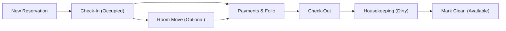

# Sky Hotel Management System — User Guide

Welcome to the **Sky Hotel Management System**! This guide walks you step-by-step through setting up, managing, and running everyday hotel operations—from taking reservations and checking guests in/out to housekeeping and billing.

---

## 1. System Overview

Sky Hotel Management System is built natively on top of Frappe and ERPNext. It manages hotel workflows while keeping your accounting, payments, and customers 100% compliant with standard ERPNext.



### Key Highlights
- **ERPNext Standard Accounting**: Generates standard Sales Invoices and Payment Entries directly linked to standard General Ledger accounts.
- **Housekeeping View**: Real-time visual cards for every room with one-click status updates.
- **Automated Lifecycle**: Checking out automatically marks rooms as `Dirty` so guests are never assigned an uncleaned room.
- **Maintenance Integration**: Opening an ERPNext `Issue` for a room automatically sets it to `Out of Order`.

---

## 2. Initial Setup (One-Time Configuration)

Before taking your first reservation, follow these 4 configuration steps in order.

### Step 1: Hotel Settings
Navigate to **Hotel** $\rightarrow$ **Hotel Settings**:
- **Company**: Select your company (e.g. *Demo*).
- **Default Room Item**: An ERPNext Item representing lodging/accommodation (e.g. `HOTEL-ROOM`).
- **Guest Customer Group**: Default group assigned to new walk-in guests (e.g. `Individual`).
- **Guest Territory**: Default territory for new guests (e.g. `All Territories`).
- **Status After Maintenance**: Status given to rooms once a repair issue is resolved (default: `Dirty`).
- **Block Checkout if Balance**: Enable this to prevent checking out guests who have an unpaid folio balance.

### Step 2: Hotel Room Types
Navigate to **Hotel** $\rightarrow$ **Hotel Room Type** $\rightarrow$ **+ Add Hotel Room Type**:
- **Room Type Name**: e.g., *Deluxe King*, *Standard Twin*, *Executive Suite*.
- **Default Rate**: The baseline night charge (e.g., \$150.00).
- **Max Adults / Max Children**: Occupancy limits.
- **Item**: Linked standard ERPNext item for room billing.

### Step 3: Hotel Rooms
Navigate to **Hotel** $\rightarrow$ **Hotel Room** $\rightarrow$ **+ Add Hotel Room**:
- **Room Number**: e.g., `101`, `102`, `201`.
- **Room Type**: Choose the type created in Step 2.
- **Floor**: Floor number (e.g., `1`, `2`, `3`).
- **Status**: Start with `Available`.
- **Is Enabled**: Checked.

> [!TIP]
> You can quickly create multiple rooms using the ERPNext Data Import tool or Frappe bench scripts if setting up a large property.

### Step 4: Room Rate Plans (Optional)
Navigate to **Hotel** $\rightarrow$ **Room Rate Plan** to set special pricing:
- Corporate discounts linked to specific Customer Groups or corporate accounts.
- Seasonal rates with explicit **Valid From** and **Valid To** date ranges.

---

## 3. Daily Front Desk Operations

### 3.1 Creating a Reservation
1. Go to **Hotel** $\rightarrow$ **Hotel Reservation** $\rightarrow$ **+ Add Hotel Reservation**.
2. **Customer / Guest**: Select an existing guest or type a new name to create one on the fly.
3. Fill in stay details:
   - **Arrival Date** and **Departure Date**.
   - **Adults** and **Children** counts.
   - **Room Type**: Select desired room tier.
4. Click **Fetch Available Rooms** to see available rooms for those dates. Select a specific room or leave blank to assign at check-in.
5. Save and Submit the reservation (Status becomes `Reserved`).

> [!NOTE]
> The reservation automatically computes the total rate based on your rate plans and sets up the primary segment in the **Stays** table.

---

### 3.2 Collecting Advance Deposits
1. On the submitted reservation, click **Make Payment** or open the **Billing Summary** section.
2. Enter the deposit amount, payment method (Cash, Credit Card, Bank Transfer), and click **Submit**.
3. A standard ERPNext **Payment Entry** is generated with reference to this reservation.
4. The reservation's **Paid Amount** and **Balance Amount** update in real time.

---

### 3.3 Guest Check-In
1. Open the reservation on arrival date.
2. Ensure an available room is selected.
3. Click the green **Check In** button at top right:
   - Reservation status updates to `Checked In`.
   - The selected room status automatically changes to `Occupied`.
   - The room's `current_reservation` is linked to this reservation.

---

### 3.4 Room Move (Mid-Stay Room Change)
If a guest requests a different room during their stay (e.g. upgrading to a suite or moving due to AC issue):
1. Open the active `Checked In` reservation.
2. Click the **Move Room** button in the top action bar.
3. In the popup dialog:
   - Select the **New Room**.
   - Enter the **Effective Date** and the **Reason for Move**.
4. Confirm:
   - The previous room is released and automatically marked `Dirty`.
   - The new room is marked `Occupied`.
   - A new segment is appended to the **Stays** table preserving full audit history.

---

### 3.5 Guest Check-Out & Folio Settlement
1. Open the active reservation.
2. Review the **Billing Summary**:
   - Total Room Charges (computed from nights stayed).
   - Payments Received (advances and interim deposits).
   - Outstanding Balance.
3. If there is a remaining balance, click **Record Payment** to settle it.
4. Click the blue **Check Out** button:
   - A standard ERPNext **Sales Invoice** is automatically created and submitted.
   - Any payments are matched against the invoice.
   - The reservation status updates to `Checked Out`.
   - **The room status is automatically set to `Dirty`**.

---

## 4. Housekeeping Management

Sky Hotel Management System includes a dedicated, responsive **Housekeeping View** designed for tablets and mobile devices used by cleaning staff.

### Accessing Housekeeping View
Navigate to **Hotel** $\rightarrow$ **Housekeeping View** or URL `/app/housekeeping-view`.

### Room Cards Color Guide

| Border Color | Room Status | Meaning | Action Button |
| :---: | :---: | :--- | :---: |
| **Green** | `Available` | Clean, inspected, and ready for booking/check-in | **Mark Dirty** |
| **Cyan / Blue** | `Reserved` | Reserved for an incoming guest (locked against other bookings) | *(Reserved)* |
| **Yellow** | `Dirty` | Vacated or needs cleaning (cannot be booked) | **Mark Clean** |
| **Dark Gray** | `Occupied` | Guest currently staying in room | **Mark Dirty** |
| **Red** | `Out of Order`| Under maintenance or repair | *(Disabled)* |

```
┌─────────────────────────────────┐
│              101                │
│            Available            │
│       [ Mark Dirty (Yellow) ]   │
└─────────────────────────────────┘
```

### Housekeeping Workflow
1. When a guest checks out, the room automatically turns **Yellow (`Dirty`)**.
2. Housekeeping cleans the room and inspects amenities.
3. Staff opens `/app/housekeeping-view` and taps **Mark Clean**.
4. The card instantly turns **Green (`Available`)** and is immediately available for front desk assignment.

---

## 5. Maintenance & Repairs

Rooms needing repairs (plumbing, electrical, AC) are tracked using standard ERPNext **Issue** documents.

1. Go to **Support** $\rightarrow$ **Issue** $\rightarrow$ **+ Add Issue**.
2. Set:
   - **Subject**: e.g. *Room 203 AC not cooling*.
   - **Hotel Room**: Select `203`.
   - **Status**: `Open`.
3. Save the Issue:
   - Room `203` is instantly set to `Out of Order` and excluded from available inventory.
4. Once repairs are completed, set the Issue status to `Closed`:
   - Room `203` automatically transitions to `Dirty` (as configured in Hotel Settings) so housekeeping can sanitize and inspect it before it is re-opened for guests.

---

## 6. Daily Reports & Consoles

All reports are available under the **Hotel** workspace:

- **Front Desk Console**: Quick operational snapshot showing total available, occupied, dirty, and out of order rooms, plus today's expected arrivals and departures.
- **House List**: Printable list of all currently in-house guests with room numbers, check-in dates, and expected departure dates.
- **Daily Arrivals Report**: Schedule of incoming guests for today with room readiness flags.
- **Daily Departures Report**: Schedule of outgoing guests today to assist front desk and housekeeping staffing.
- **Room Availability Report**: Matrix showing room status across custom date ranges.

---

## 7. Frequently Asked Questions (FAQ)

### Q: Why do I see "ERR_CONNECTION_REFUSED" when visiting the site?
Ensure you access the server using port `:8000`:
```text
http://<server-ip>:8000
```
Also verify that `bench start` is running in your server terminal.

### Q: Why is a room not appearing in the available rooms list?
A room will not be listed if:
1. It is currently `Occupied` by an active reservation.
2. It is `Dirty` (housekeeping must mark it clean first).
3. It is `Out of Order` (maintenance issue open).
4. Another guest has a confirmed future reservation overlapping those dates.

### Q: Can we check out a guest if they still owe money?
If **Block Checkout if Balance** is checked in *Hotel Settings*, the system prevents check-out until the balance is \$0.00. To override for corporate accounts with credit terms, you can disable this option in *Hotel Settings*.

### Q: How do room charges get posted to the General Ledger?
Upon check-out, the system creates a standard ERPNext **Sales Invoice** debiting Accounts Receivable (or Cash/Bank) and crediting your Hotel Accommodation Income Account. All transactions flow naturally into standard Profit & Loss and Balance Sheet reports.
